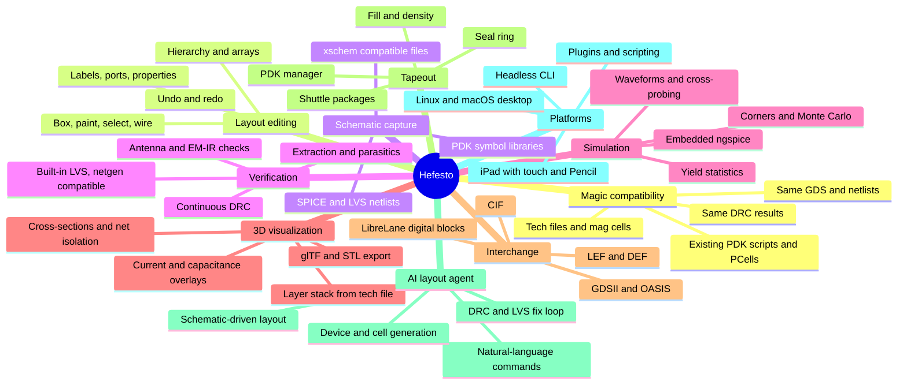
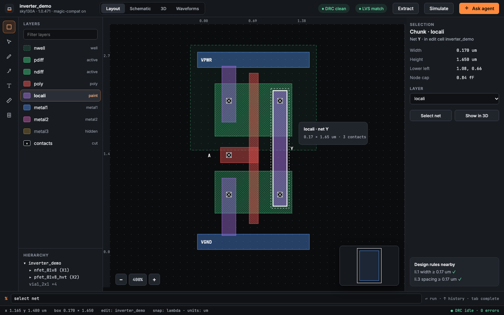
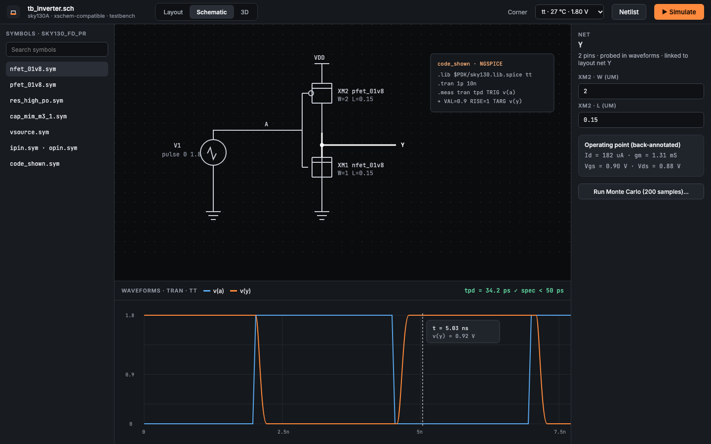
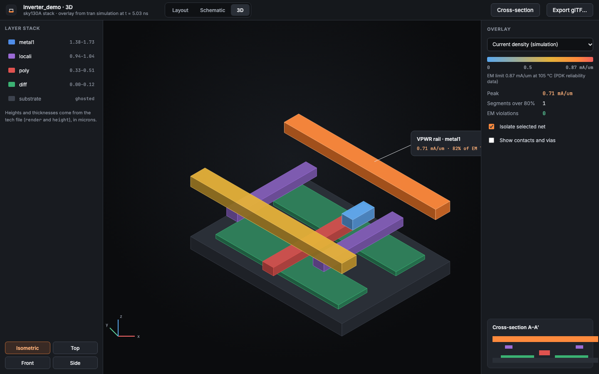
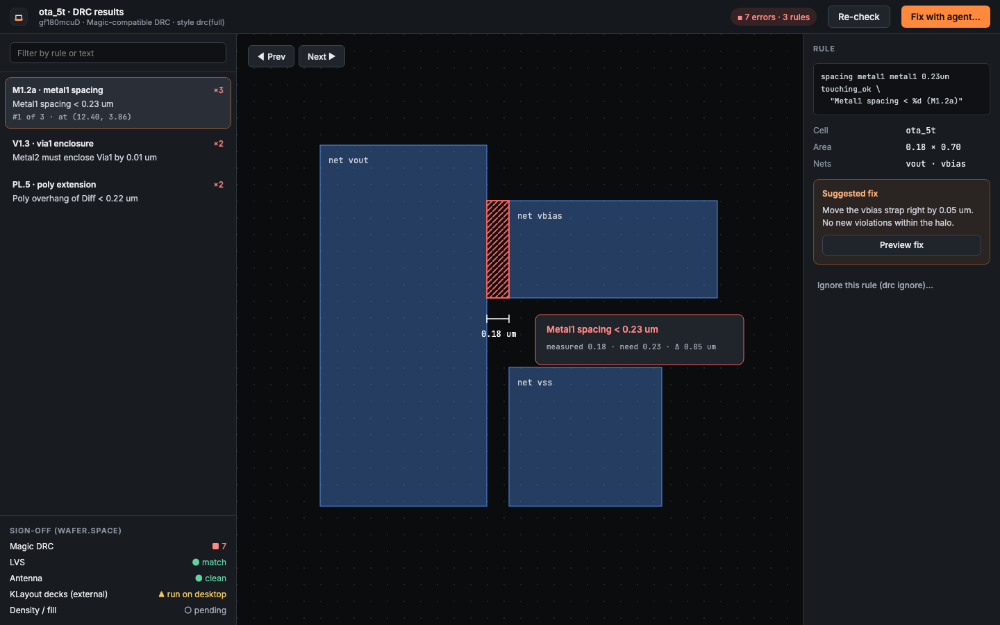
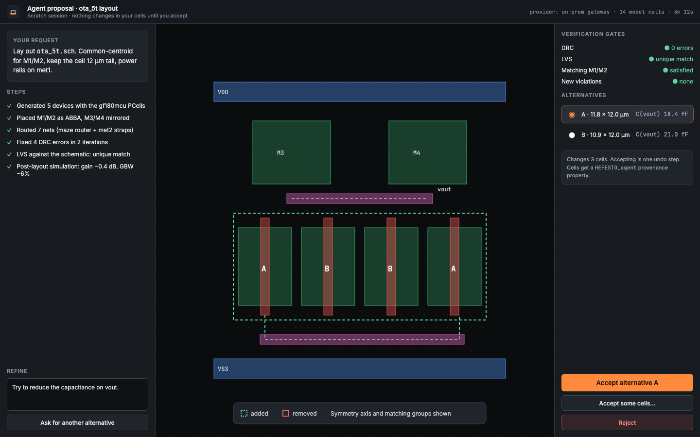
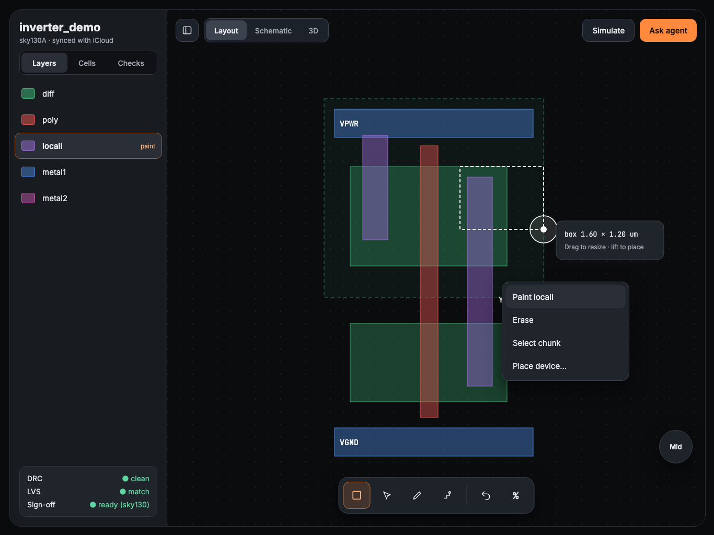
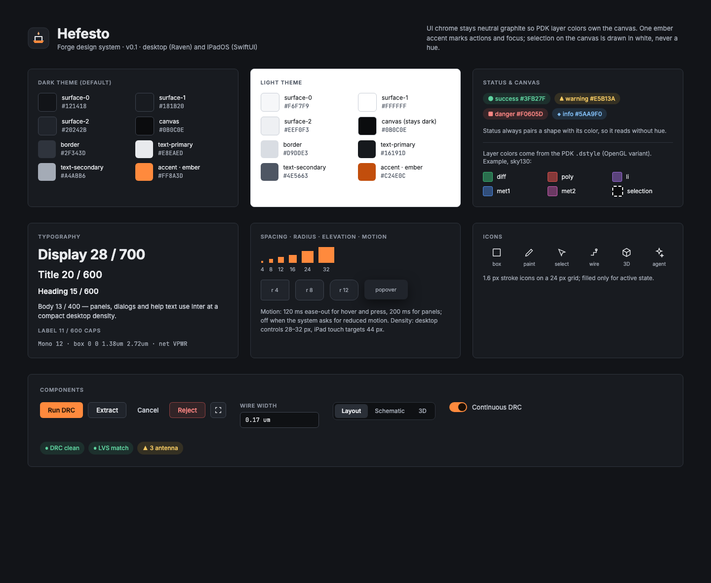

# Hefesto

[](https://github.com/CyberdyneCorp/Hefesto/actions/workflows/openspec-validate.yml)
[](LICENSE)

**Hefesto is a VLSI chip design tool written in C++20.** You draw schematics, lay out transistors and cells, check design rules, extract parasitics, run LVS, simulate with ngspice, inspect the result in 3D, and package the design for a fabrication shuttle. It runs on Linux and macOS, and later on iPad.

It is **data-compatible with [Magic VLSI](https://github.com/RTimothyEdwards/magic)**. Hefesto reads and writes the same files as Magic, and produces the same DRC results, GDS and netlists. So the open PDKs, sky130, gf180mcu and IHP sg13g2, work unchanged.

> **Status: M0 (foundations) merged, with the Raven go/no-go still provisional; M1 (core model, formats, 2D viewer) implemented, with its exit verification in progress.**
> - **Specs:** 169 capabilities and 1,979 requirements. Milestones M0 and M1 pass the readiness gate.
> - **Code:** the headless core reads Magic technology files (including sky130A), holds layouts in a corner-stitched database with Magic's tile order, reads and writes `.mag` cells (all 441 sky130 standard cells round-trip byte-identical), keeps crash backups and file locks like Magic, loads `.dstyle`/`.cmap` styles and outline fonts, runs Magic's view commands, manages PDK installs (sky130, gf180mcu, IHP sg13g2; with progress, update checks and offline packs) and starts up like Magic. `hefesto-cli` runs all of it; the desktop app shows the Desktop-Layout screen of the forge design system over Raven and the Vulkan canvas. All 142 golden cases are captured from Magic: 123 match and 19 differ only where a documented decision says so ([`tests/golden/deviations.toml`](tests/golden/deviations.toml)). Build instructions: [`docs/building.md`](docs/building.md).
> - **Raven go/no-go:** provisional "GO, conditional"; see [`docs/decisions/raven-go-no-go.md`](docs/decisions/raven-go-no-go.md).
> - **Screenshots:** the images below are design mockups, not running software.

## Features



## Screenshots (design mockups)

The screens below are the reference designs for the forge design system (capability `hefesto-design-system`). They show the intended product; they are not captures of running software.

### Layout editor (desktop)
Layer palette, hierarchy, canvas with selection and minimap, inspector with nearby design rules, command bar and status bar.



### Schematic capture and waveforms
xschem-compatible schematic with PDK symbols, a testbench code block, ngspice waveforms with a measurement check, and back-annotated operating points.



### 3D inspection
The layer stack built from the tech file, with a current-density overlay from simulation and the electromigration limit taken from PDK data.



### DRC results browser
Violations grouped by rule, the measured value against the required value, a suggested fix, and the sign-off checklist for a shuttle.



### AI agent proposal review
The agent works in a scratch copy and shows its steps, a visual diff, verification gates and alternatives. Nothing changes until you accept.



### iPad
Full-screen canvas, a floating tool palette with 44 pt+ touch targets, a long-press action menu and a floating modifier button.



### Design system
Forge tokens: graphite UI chrome, one ember accent, Inter and JetBrains Mono. Layer colors always come from the PDK.



## Platforms and technology

| | Desktop (first) | iPad (after desktop 1.0) |
|---|---|---|
| OS | Linux (glibc 2.31+, x86_64, aarch64), macOS 14+ on Apple silicon | iPadOS 17+ |
| UI | C++20 on [Raven](https://github.com/oscar-soirey/Raven) | Swift and SwiftUI |
| Rendering | Vulkan (MoltenVK on macOS) | Metal |
| Core | Shared C++20 core, CMake, headless CLI | Same core |
| Scripting | Sandboxed embedded Tcl (`magic::` API) | Same, sandboxed |

## Roadmap

| Milestone | Theme | Release |
|---|---|---|
| M0 | Foundations, Raven go/no-go, golden capture from Magic (merged; go/no-go provisional) | |
| M1 | Core model, tech and `.mag` files, PDK manager, 2D viewer (implemented; exit verification in progress) | |
| M2 | Interactive editing and design system | |
| M3 | Design rule checking | |
| M4 | Scripting and PDK integration | Desktop Alpha |
| M5–M7 | Masks, GDS/CIF, LEF/DEF/OASIS, extraction and netlisting | |
| M8 | Schematic capture | |
| M9 | LVS and simulation, including advanced analog | Desktop Beta |
| M10–M12 | 3D, EM/IR, digital flow, AI agent, legacy tools | |
| M13 | Tapeout readiness, plugins, operations | Desktop 1.0 |
| M14 | iPad app | iPad 1.0 |

Details, gates and the de-risking schedule are in [`docs/roadmap.md`](docs/roadmap.md).

## How the specification works

- Specs are written with [OpenSpec](https://github.com/Fission-AI/OpenSpec), one folder per capability in [`openspec/specs/`](openspec/specs/). [`docs/specs-index.md`](docs/specs-index.md) is the map.
- Every requirement declares a compatibility class:
  - `exact`: output identical to Magic, netgen or ngspice
  - `behavioral`: same results, the interface may differ
  - `informative`: reference only
  - `native`: Hefesto-only

  Each requirement also traces to the Magic source or to a product decision. See [`docs/spec-conventions.md`](docs/spec-conventions.md).
- Decisions are recorded in [`docs/decisions/`](docs/decisions/):
  - product decisions P-1 to P-23
  - cross-cutting decisions X-1 to X-6
  - audit decisions
  - open questions per area, each with a `Resolution:` line
- [`tests/golden/`](tests/golden/) lists the compatibility cases to capture from the reference tools.
- [`docs/glossary.md`](docs/glossary.md) defines the shared terms.
- [`docs/reference/magic/`](docs/reference/magic/) is a non-normative overview of Magic 8.3.694.

Building, testing and contributing: [`docs/building.md`](docs/building.md) and [`docs/contributing/README.md`](docs/contributing/README.md).

Spec checks that CI runs on every push:

```sh
openspec validate --all --strict                          # specs are well-formed
python3 scripts/check_roadmap_coverage.py                 # every capability is in a milestone
python3 scripts/gen_specs_index.py && git diff --exit-code docs/specs-index.md
python3 scripts/check_milestone_readiness.py --through M1 # open questions resolved for M0 and M1
```

## License

Apache License 2.0. See [LICENSE](LICENSE). Third-party components and the clean-room rules for GPL-licensed reference tools (netgen, KLayout, xschem) are described in capability `hefesto-licensing`.
