# Hefesto

[](https://github.com/CyberdyneCorp/Hefesto/actions/workflows/openspec-validate.yml)
[](LICENSE)

**Hefesto is a VLSI chip design tool written in C++20.** You draw schematics, lay out transistors and cells, check design rules, extract parasitics, run LVS, simulate with ngspice, inspect the result in 3D, and package the design for a fabrication shuttle. It runs on Linux and macOS, and later on iPad.

It is **data-compatible with [Magic VLSI](https://github.com/RTimothyEdwards/magic)**. Hefesto reads and writes the same files as Magic, and produces the same DRC results, GDS and netlists. So the open PDKs, sky130, gf180mcu and IHP sg13g2, work unchanged.

> **Status: M0 (foundations) merged, Raven go/no-go final (GO); M1 (core model, formats, 2D viewer) complete; M2 (interactive editing and design system) complete; M3 (design rule checking) complete pending merge.**
> - **Specs:** 169 capabilities and 1,987 requirements. Milestones M0 to M3 pass the readiness gate; M3 requirement coverage is 69 of 69.
> - **Code:** the headless core reads Magic technology files (including sky130A), holds layouts in a corner-stitched database with Magic's tile order, reads and writes `.mag` cells (all 441 sky130 standard cells round-trip byte-identical), keeps crash backups and file locks like Magic, loads `.dstyle`/`.cmap` styles and outline fonts, runs Magic's view commands, manages PDK installs (sky130, gf180mcu, IHP sg13g2; with progress, update checks and offline packs) and starts up like Magic. M2 adds Magic's editing command set (box, paint, erase, select, move, copy, stretch, arrays, hierarchy, labels, ports, properties), layout undo/redo, connectivity selection, the wiring tool, command dispatch with macros, key bindings and tools, highlights and feedback, and the color window. M3 adds Magic's DRC: the technology `drc` section compiled for every style, the edge-based check kernel with Magic's rule semantics (including Euclidean distances and mask-hint exceptions), hierarchical and array interaction checks, the background checker on a worker thread under the database's shared lock, and the `drc` command set; the sky130 and gf180mcu standard cells give Magic's error sets exactly. `hefesto-cli` runs all of it (`--interactive` runs the background checker at Magic's `%`/`]` prompt); the desktop app is an editor over Raven and the Vulkan canvas, with a live DRC status chip and a DRC results browser. Golden cases captured from Magic: 399; 356 match and 43 differ only where a documented decision or a later milestone's feature says so ([`tests/golden/deviations.toml`](tests/golden/deviations.toml)). Build instructions: [`docs/building.md`](docs/building.md).
> - **Raven go/no-go:** GO, final for M2 (2026-11-10), on the Apple M3 Pro measurements and the Linux CI job; the reference M1 frame-rate run, Linux live input and Orca are M4 confirmation checks. See [`docs/decisions/raven-go-no-go.md`](docs/decisions/raven-go-no-go.md).
> - **Screenshots:** [the running app at M3](#screenshots-running-app-m3) (DRC on sky130) and [at M2](#screenshots-running-app-m2) (desktop editor on sky130), followed by the [design mockups](#screenshots-design-mockups) of screens later milestones build.

## Features

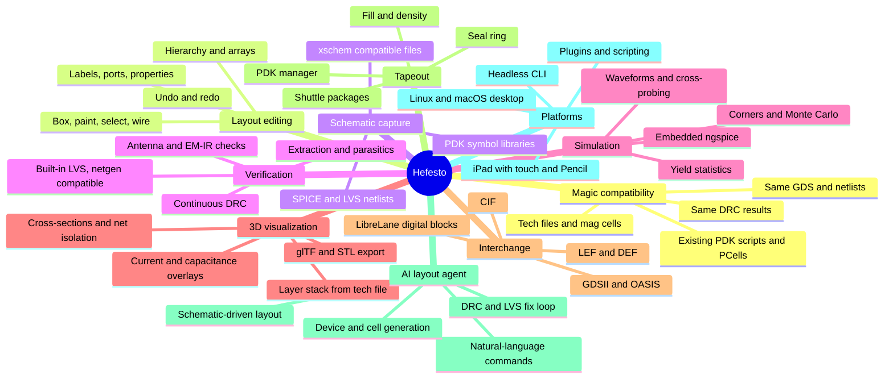

## Screenshots (running app, M3)

Captures of the desktop app checking `sky130_fd_sc_hd__dfxtp_1` with two metal1 squares painted too close, taken with `--run 'CMD; …' --capture FILE` (commands in [`docs/design/m3-ui-conformance.md`](docs/design/m3-ui-conformance.md)).

### DRC results browser

After `drc check; drc catchup`: the DRC chip and status bar show the error count, the DRC panel groups the errors by why-text, and Prev/Next step through them in `drc find` order (`#3 of 11`), with the error area under the box in the inspector.

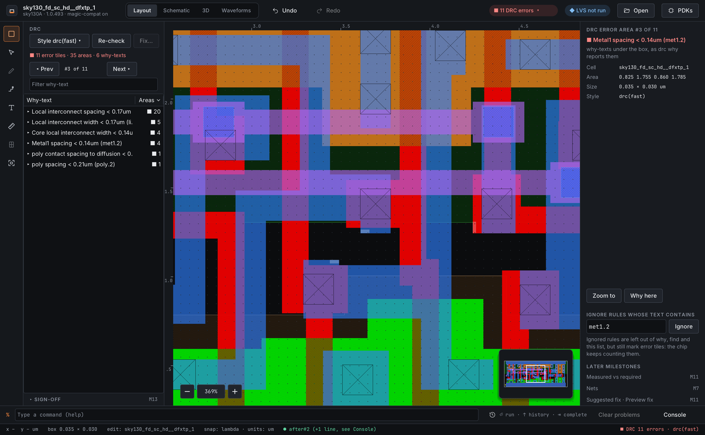

### `drc why`

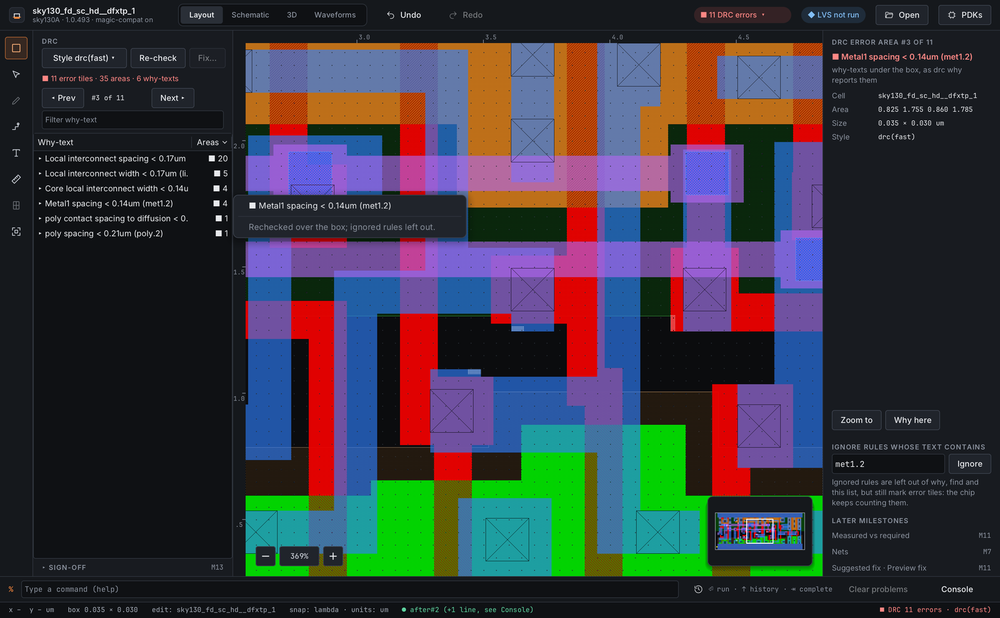

### Ignored rules, light theme

`drc ignore li.3`: the ignored rule is listed apart and left out of the groups.

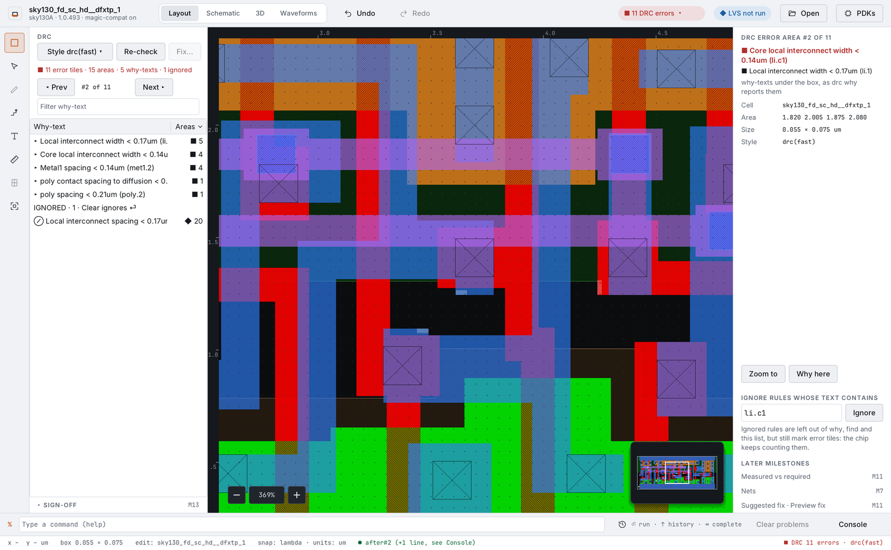

### Not run

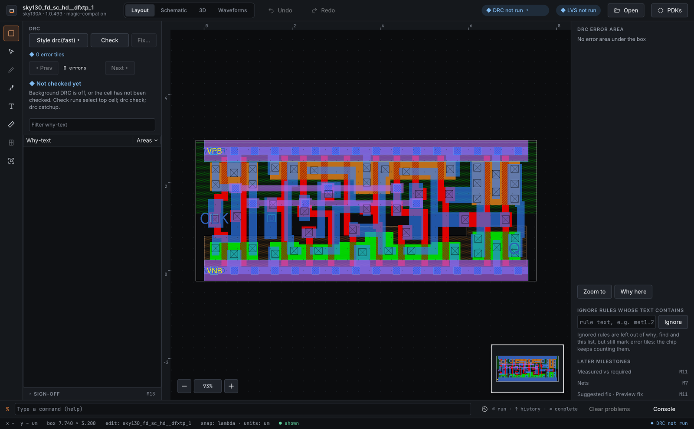

## Screenshots (running app, M2)

Captures of the current desktop app (macOS, Vulkan through MoltenVK) editing `sky130_fd_sc_hd__dfxtp_1` from the sky130A PDK. They were taken with the app's scripted capture option (`--run 'CMD; …' --capture FILE`), so they show the real program.

### Selection and inspector

`select area metal1` inside the box: the selection is outlined on the canvas and the inspector lists it, with actions that run `select net`, `what` and `delete`.

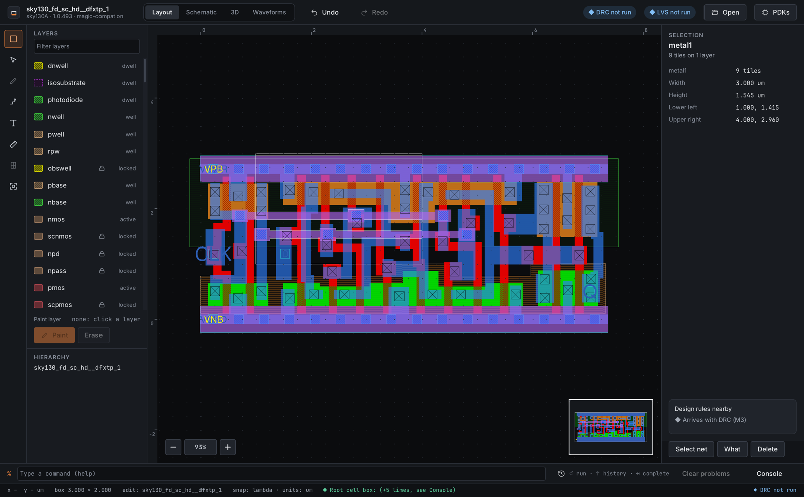

### Light theme

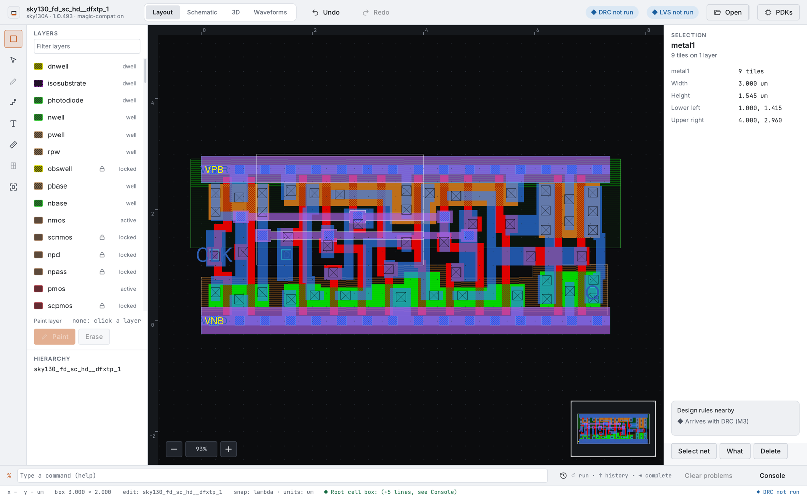

### Color window

`specialopen color 47`: Magic's color window as a docked panel, with the RGB/HSV bars and pumps, load and save.

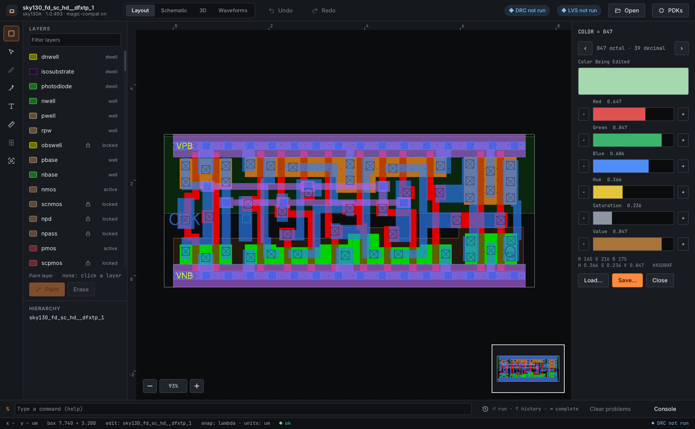

### Key bindings

The Keys tab lists every macro table, the current tool's first; choosing a row puts the `macro` command in the command bar to edit it.

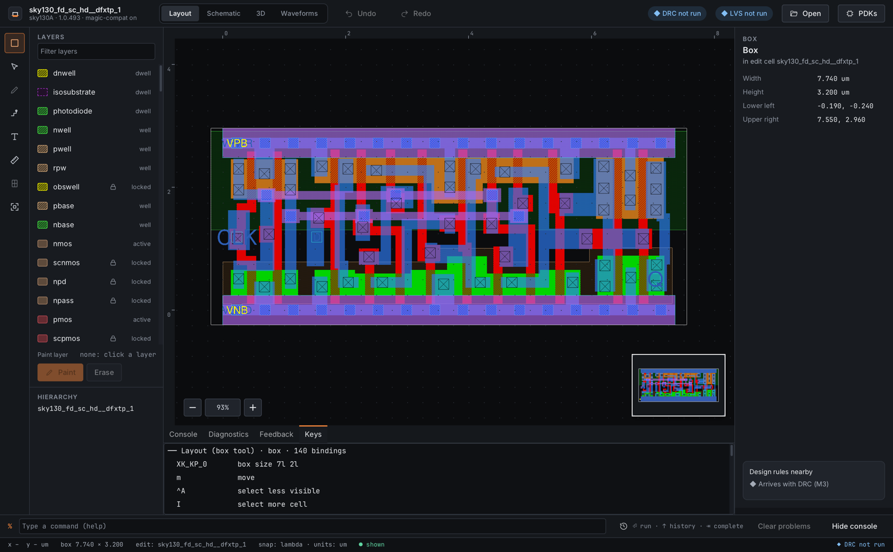

### Hierarchy

`sky130_fd_sc_hd__macro_sparecell` with its subcells expanded.

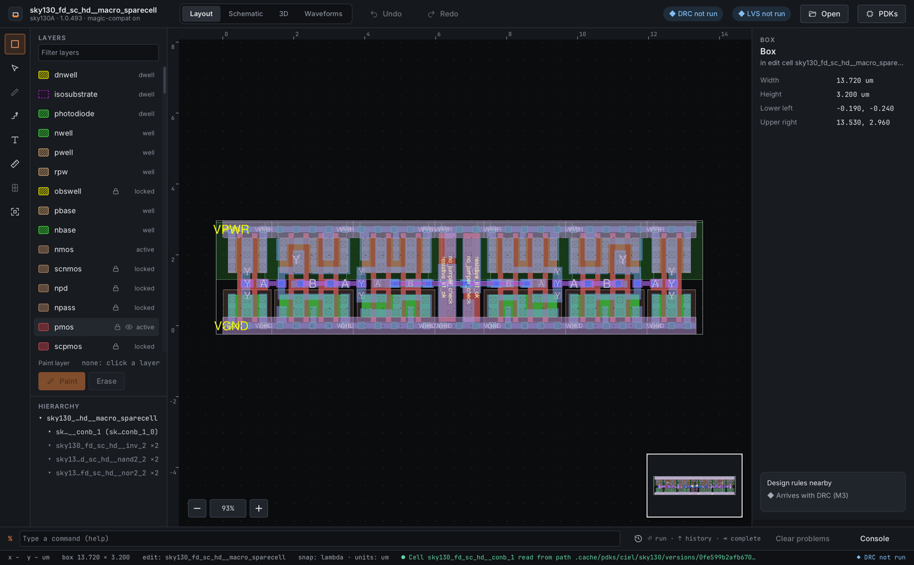

## Screenshots (design mockups)

The screens below are the reference designs for the forge design system (capability `hefesto-design-system`). They show the intended product; they are not captures of running software.

### Layout editor (desktop)
Layer palette, hierarchy, canvas with selection and minimap, inspector with nearby design rules, command bar and status bar.


### Schematic capture and waveforms
xschem-compatible schematic with PDK symbols, a testbench code block, ngspice waveforms with a measurement check, and back-annotated operating points.


### 3D inspection
The layer stack built from the tech file, with a current-density overlay from simulation and the electromigration limit taken from PDK data.


### DRC results browser
The approved M3 board: errors grouped by why-text with counts, `#k of n` stepping on the canvas, the error-area inspector, ignored rules and the style selector, and the DRC status chip. The measured value against the required value, nets, a suggested fix and the sign-off summary arrive in later milestones.

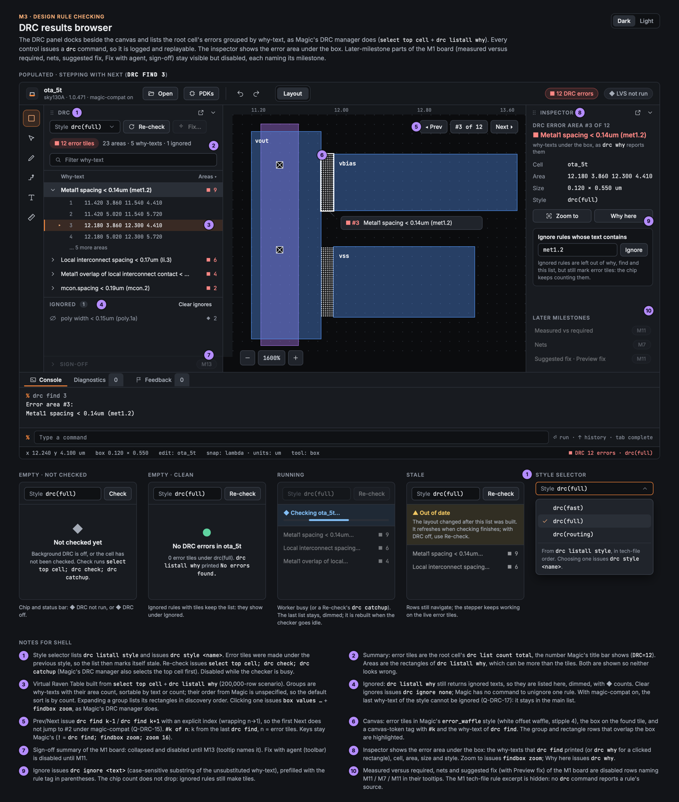

### AI agent proposal review
The agent works in a scratch copy and shows its steps, a visual diff, verification gates and alternatives. Nothing changes until you accept.


### iPad
Full-screen canvas, a floating tool palette with 44 pt+ touch targets, a long-press action menu and a floating modifier button.


### Design system
Forge tokens: graphite UI chrome, one ember accent, Inter and JetBrains Mono. Layer colors always come from the PDK.


## Platforms and technology

| | Desktop (first) | iPad (after desktop 1.0) |
|---|---|---|
| OS | Linux (glibc 2.31+, x86_64, aarch64), macOS 14+ on Apple silicon | iPadOS 17+ |
| UI | C++20 on [Raven](https://github.com/oscar-soirey/Raven) | Swift and SwiftUI |
| Rendering | Vulkan (MoltenVK on macOS) | Metal |
| Core | Shared C++20 core, CMake, headless CLI | Same core |
| Scripting | Sandboxed embedded Tcl (`magic::` API) | Same, sandboxed |

## Roadmap

| Milestone | Theme | Release |
|---|---|---|
| M0 | Foundations, Raven go/no-go, golden capture from Magic (merged; go/no-go final: GO) | |
| M1 | Core model, tech and `.mag` files, PDK manager, 2D viewer (complete) | |
| M2 | Interactive editing and design system (complete) | |
| M3 | Design rule checking (complete pending merge) | |
| M4 | Scripting and PDK integration | Desktop Alpha |
| M5–M7 | Masks, GDS/CIF, LEF/DEF/OASIS, extraction and netlisting | |
| M8 | Schematic capture | |
| M9 | LVS and simulation, including advanced analog | Desktop Beta |
| M10–M12 | 3D, EM/IR, digital flow, AI agent, legacy tools | |
| M13 | Tapeout readiness, plugins, operations | Desktop 1.0 |
| M14 | iPad app | iPad 1.0 |

Details, gates and the de-risking schedule are in [`docs/roadmap.md`](docs/roadmap.md).

## How the specification works

- Specs are written with [OpenSpec](https://github.com/Fission-AI/OpenSpec), one folder per capability in [`openspec/specs/`](openspec/specs/). [`docs/specs-index.md`](docs/specs-index.md) is the map.
- Every requirement declares a compatibility class:
  - `exact`: output identical to Magic, netgen or ngspice
  - `behavioral`: same results, the interface may differ
  - `informative`: reference only
  - `native`: Hefesto-only

  Each requirement also traces to the Magic source or to a product decision. See [`docs/spec-conventions.md`](docs/spec-conventions.md).
- Decisions are recorded in [`docs/decisions/`](docs/decisions/):
  - product decisions P-1 to P-23
  - cross-cutting decisions X-1 to X-6
  - audit decisions
  - open questions per area, each with a `Resolution:` line
- [`tests/golden/`](tests/golden/) lists the compatibility cases to capture from the reference tools.
- [`docs/glossary.md`](docs/glossary.md) defines the shared terms.
- [`docs/reference/magic/`](docs/reference/magic/) is a non-normative overview of Magic 8.3.694.

Building, testing and contributing: [`docs/building.md`](docs/building.md) and [`docs/contributing/README.md`](docs/contributing/README.md).

Spec checks that CI runs on every push:

```sh
openspec validate --all --strict                          # specs are well-formed
python3 scripts/check_roadmap_coverage.py                 # every capability is in a milestone
python3 scripts/gen_specs_index.py && git diff --exit-code docs/specs-index.md
python3 scripts/check_milestone_readiness.py --through M1 # open questions resolved for M0 and M1
```

## License

Apache License 2.0. See [LICENSE](LICENSE). Third-party components and the clean-room rules for GPL-licensed reference tools (netgen, KLayout, xschem) are described in capability `hefesto-licensing`.
